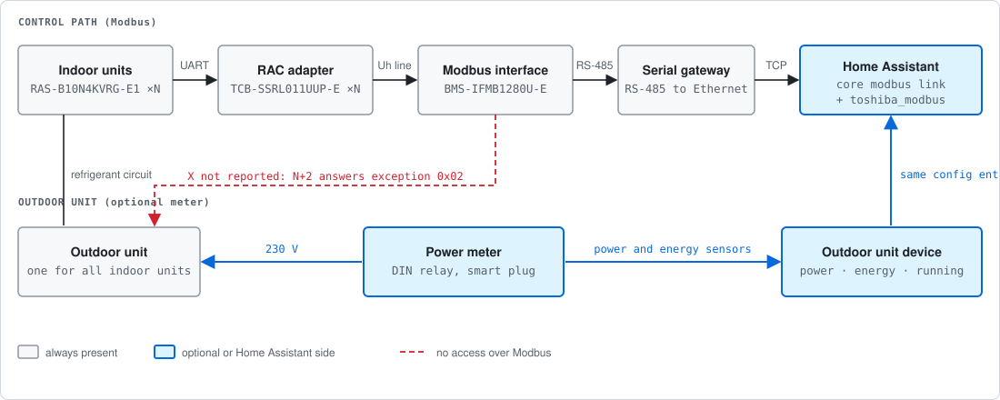
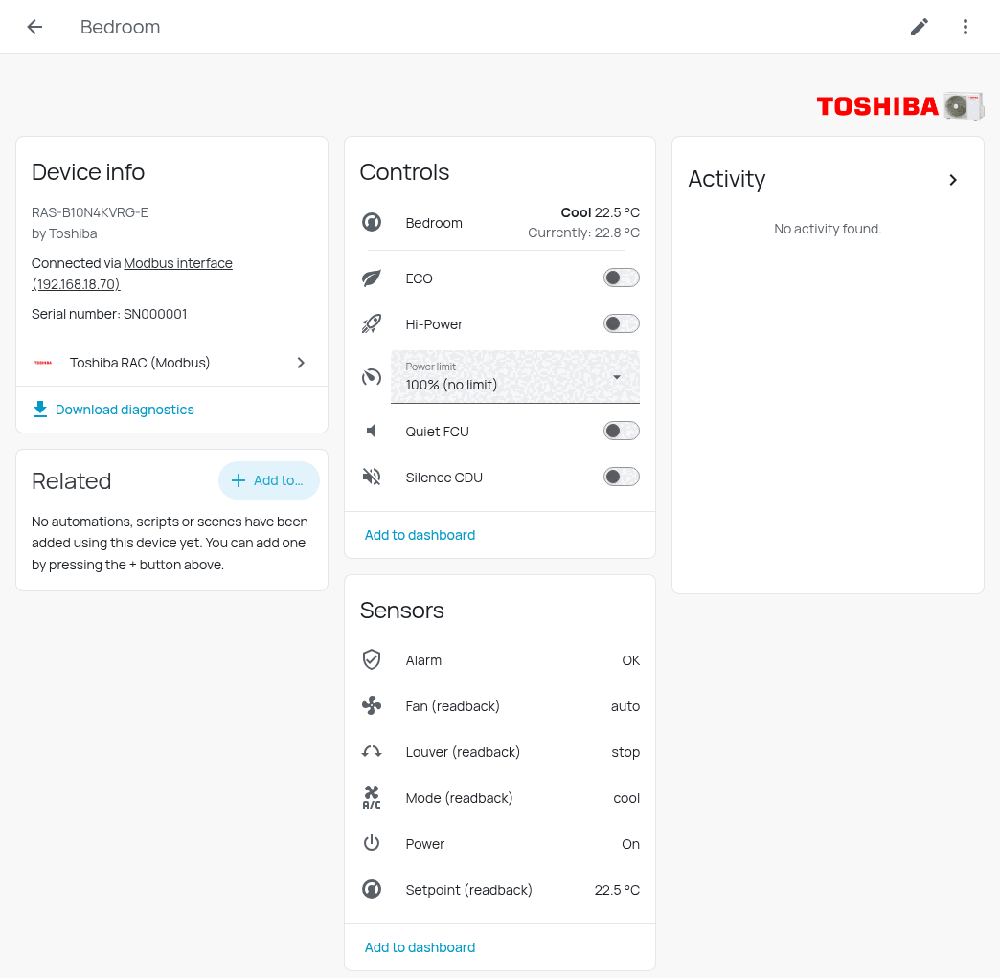
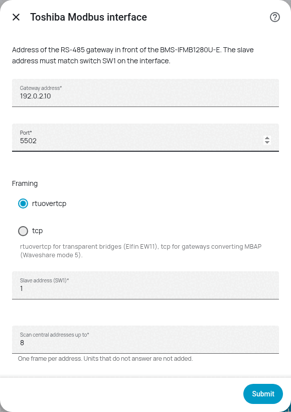
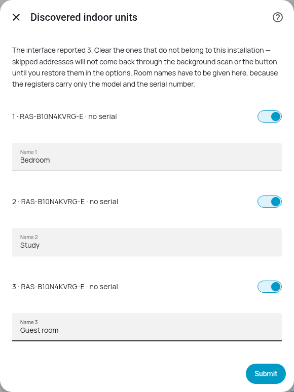

# Toshiba AC (Modbus) for Home Assistant

[](https://github.com/jrx-code/hassio-toshiba-modbus/releases/latest)
[](https://github.com/jrx-code/hassio-toshiba-modbus/actions/workflows/validate.yml)
[](https://hacs.xyz)
[](LICENSE)

Local control of Toshiba residential air conditioners through the **BMS-IFMB1280U-E** Modbus interface
and one **TCB-SSRL011UUP-E** RAC adapter per indoor unit. No cloud, no vendor account, no polling of a remote API.



## What you get

- **A `climate` entity per indoor unit** with power, setpoint, mode, fan and swing, and the check code decoded into
  text (`19: TD sensor (Discharge pipe temperature sensor) error`), outdoor-unit faults included.
- **The controls the remote has and the cloud app hides:** power limit, Hi-Power, ECO, Quiet FCU, Silence CDU and the
  six remote-controller locks, as `select` and `switch` entities.
- **A device per unit and one for the interface**, with model and serial number, a connectivity sensor and bus diagnostics
  that tell a noisy RS-485 line from a second master on the gateway.
- **The outdoor unit, with a power meter** (optional): power, energy and a *Running* sensor, from any meter on its supply.
  The interface reports nothing about the outdoor unit itself.
- **Units that join later** are found by a button or a background scan, without a restart.



## Quick start

1. **Install** with HACS (it is in the default store) or from the release zip, then restart Home Assistant.
   Requires Home Assistant **2026.9** or later. See [Installation](docs/installation.md).
2. *Settings, Devices & services, Add integration, Toshiba AC (Modbus)*, and enter the address of the RS-485 gateway,
   the framing and the slave address from switch **SW1**.
3. Tick and name the units. Optionally type the serial numbers and choose a power meter for the outdoor unit.
   See [Configuration](docs/configuration.md).

<p>


</p>

## Documentation

| | |
|---|---|
| [Installation](docs/installation.md) | Requirements, interface settings that decide whether it works, HACS and manual install |
| [Configuration](docs/configuration.md) | Every step of the setup and the options, units that appear later, the outdoor-unit meter |
| [Entities](docs/entities.md) | Every entity and attribute, check codes, why there is no `hvac_action` |
| [Automations](docs/automations.md) | Window and alarm automations, energy per day, month and year, a dashboard card |
| [Troubleshooting](docs/troubleshooting.md) | Setup errors, unavailable entities, a noisy bus |
| [Hardware notes](docs/hardware.md) | What cost time to find, and what Modbus cannot give you |
| [Contributing](CONTRIBUTING.md) | Tests, the emulator, releasing |
| [Changelog](CHANGELOG.md) | What changed in each version |

## Why not the built-in `modbus` integration

It works, and for a first light it is the faster route. It also has limits this map runs straight into:

| | Built-in `modbus` | This integration |
|---|---|---|
| Devices in the registry | none, `entity.py` sets no `DeviceInfo` | one device per indoor unit, model and serial read from registers `30007` / `30015` |
| Frames per poll (3 units) | 96, one transaction per entity | 21, reads merged into contiguous blocks |
| Power limit (`40011`), remote-controller lock (`40010`) | no `select`, no `number` platform; scripts only | `select` and six `switch` entities |
| Missing indoor unit | valid frame of zeros, shown as real data | `unavailable`, detected from the model name |
| Mode / fan / louver names, check codes | numbers, mapped in templates | mapped and decoded in the integration |

Since 0.4.0 the integration borrows its Modbus link from the core `modbus` integration, which shares one connection per
gateway between everything that asks for it and queues the requests, so the two can run side by side.

## Testing without hardware

`tools/emulator.py` is a dependency-free Modbus RTU-over-TCP server that answers like the real interface, including the
three slave addresses, the zero-filled frame for a missing unit and function `0x08`:

```bash
python3 tools/emulator.py --port 5502 --units 1,2,3 --absent 3
```

Add the integration against `<host>:5502` with framing `rtuovertcp`. See [Contributing](CONTRIBUTING.md#tests) for the tests.

## Icons

Two kinds, both local to the component, so no pull request to `home-assistant/brands` and no manifest key.
`brand/` holds the integration artwork (measured on Home Assistant 2026.7.4):

| Where in the UI | Light theme | Dark theme |
|---|---|---|
| Integration tile, "Select brand" dialog, device list, device page row | `icon.png` | `dark_icon.png` |
| Integration page header (80 px) | `icon@2x.png` | `dark_icon@2x.png` |
| Badge in the top-right corner of a device page | `logo.png` | `dark_logo.png` |
| Config-flow dialog | none | none |

`icons.json` maps every entity to an MDI icon by its translation key. Editing the artwork takes effect on the next request,
so a browser hard refresh is enough, no restart.

## License

**Apache License 2.0.** Copyright 2026 JI ENGINEERING.

The point of picking Apache over MIT here is `NOTICE`: section 4(d) obliges any derivative work you distribute to carry a
readable copy of the attribution notices from that file, in its own `NOTICE`, in the documentation, or wherever third-party
notices normally appear in the product. So a fork keeps the credit whether or not anyone opens `LICENSE`. In short,
redistribution requires shipping a copy of the licence (4a), marking the files you changed (4b), keeping the copyright, patent,
trademark and attribution notices found in the source (4c) and carrying the contents of `NOTICE` (4d). In exchange the
licence grants an explicit patent licence (section 3), which MIT does not. Every source file carries
`SPDX-License-Identifier: Apache-2.0`.

Toshiba and the Toshiba logo are trademarks of Toshiba Corporation. This project is not affiliated with, authorised by or
endorsed by it; the artwork in `custom_components/toshiba_modbus/brand/` is built from the manufacturer's own product images
and identifies the hardware the integration talks to.

The Modbus link comes from Home Assistant's core `modbus` integration and its `modbus-connection` library (Apache-2.0); the
integration adds no runtime dependency of its own.
