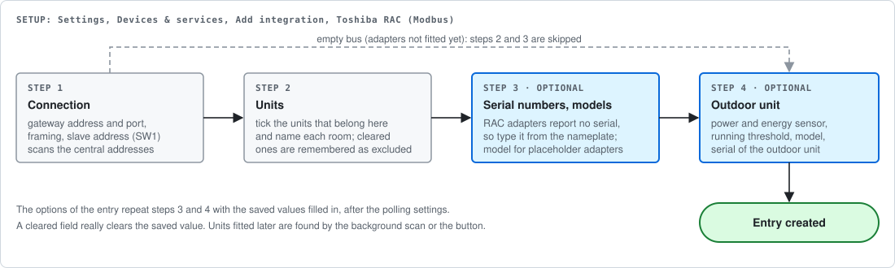
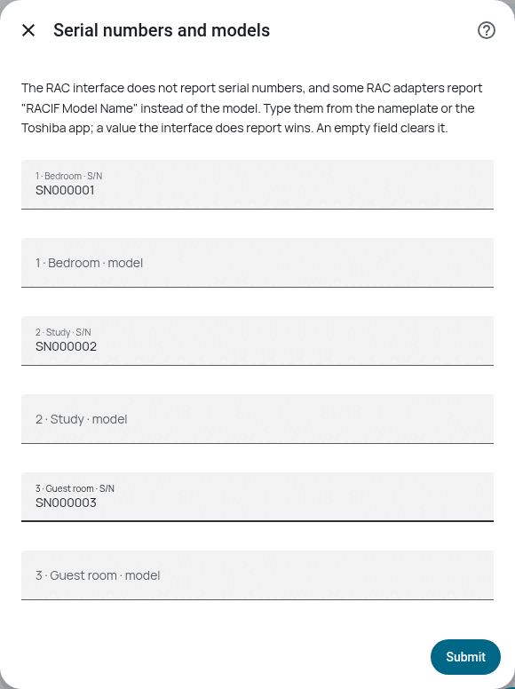
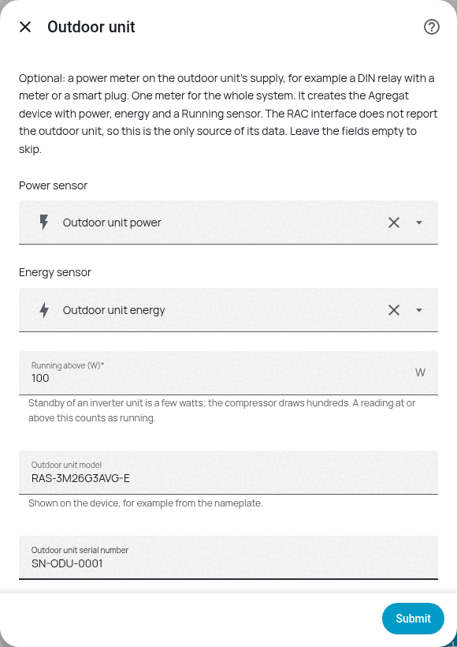

# Configuration

*Settings, Devices & services, Add integration, Toshiba AC (Modbus).*

## Step 1: connection

| Field | Meaning |
|---|---|
| Gateway address / port | The RS-485 gateway in front of the interface, not the interface itself. Serial bridges typically listen on 8899 or 502; `tools/emulator.py` defaults to 5502 |
| Framing | `rtuovertcp` for transparent bridges (Elfin EW11), `tcp` for gateways doing MBAP to RTU conversion (Waveshare mode 5) |
| Slave address | Must equal switch **SW1** on the interface board |
| Scan central addresses up to | One frame per address; units that do not answer are skipped |
| Poll every | Seconds between cycles. Default 30; three units take about 24 s of it |
| Look for new units every | Background scan for adapters fitted later. `0` leaves the button as the only route |

Setup reads the model name of each candidate address, then the serial number of the ones that answer.

## Step 2: units

One dialog: a checkbox per unit labelled with its address, model and serial, and a name field beside
it. An interface serves up to 64 central addresses and not all of them have to belong to this
installation, so clear what you do not want. Names have to be typed here, because the registers carry
the model and the serial, never a location.

A cleared address is remembered as excluded, so neither the background scan nor the button brings it
back. Restore it later under *Configure* on the entry.

**An interface with no indoor units is a valid setup.** Before the RAC adapters are fitted the Uh bus
is empty; the entry is created anyway, with the interface as its only device, and steps 2 and 3 are skipped.

## Step 3: serial numbers and models (optional)

A RAC adapter answers the serial register with `0xFF` only, so for RAC units the serial is typed in
from the nameplate or the Toshiba app. A value the interface does report always wins over a typed one.
The model field is for adapters that answer the model register with the placeholder `RACIF Model Name`.
Both can be changed later under *Configure*; an empty field clears the saved value.

## Step 4: outdoor unit (optional)

A multisplit has one outdoor unit for several indoor ones, and the RAC interface does not report it at
all. If the outdoor unit's supply goes through a power meter that Home Assistant can read, pick it here:

| Field | Meaning |
|---|---|
| Power sensor | Any `sensor` with device class `power` (a DIN relay with a meter, a smart plug) |
| Energy sensor | Any `sensor` with device class `energy`. Unit and state class are copied from it |
| Running above (W) | Power at or above this counts as running. Standby of an inverter unit is a few watts, the compressor draws hundreds. Default 100 W |
| Outdoor unit model, serial | Shown on the device |

This creates one **Outdoor unit** device with power, energy and a *Running* sensor. One meter covers the
whole system, so it says that the outdoor unit works, not which room asked for it; for the same reason there is
no `hvac_action` on the climate entities.

> **Pick an energy sensor that only goes up.** Some meters report energy of the *last hour*, a value that
> falls as the window moves. Home Assistant treats every fall as a reset and the daily and monthly
> statistics become wrong. In that case leave the energy field empty and integrate the power instead,
> see [Automations](automations.md#energy-per-day-month-and-year).

## Units that appear later

Adapters get fitted one at a time, so discovery is not a one-off event:

- **Find indoor units**: a button on the interface device. Press it after fitting an adapter instead of waiting.
- **Background rescan**: every *Look for new units every* seconds (default 300) the integration scans only the
  addresses it does not know yet, so once the full set is found it costs nothing.

A unit found this way is read once immediately, then its device and entities are created, without a
restart and without reloading the entry.

## Options

*Configure* on the entry repeats the polling settings, the serial numbers and models, and the outdoor
unit, with the saved values filled in. Saving reloads the entry. The first read of every unit takes about seven seconds per unit on the
bus (a three-unit site: roughly twenty-five seconds), during which the entities are unavailable.
