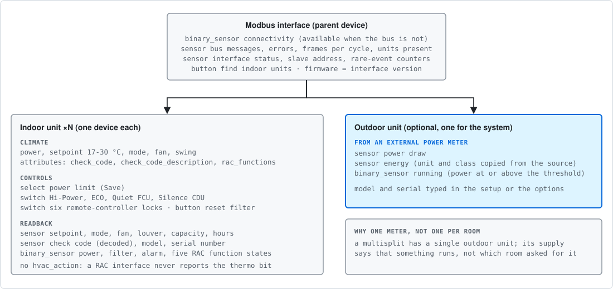
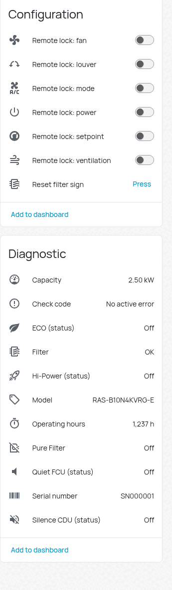
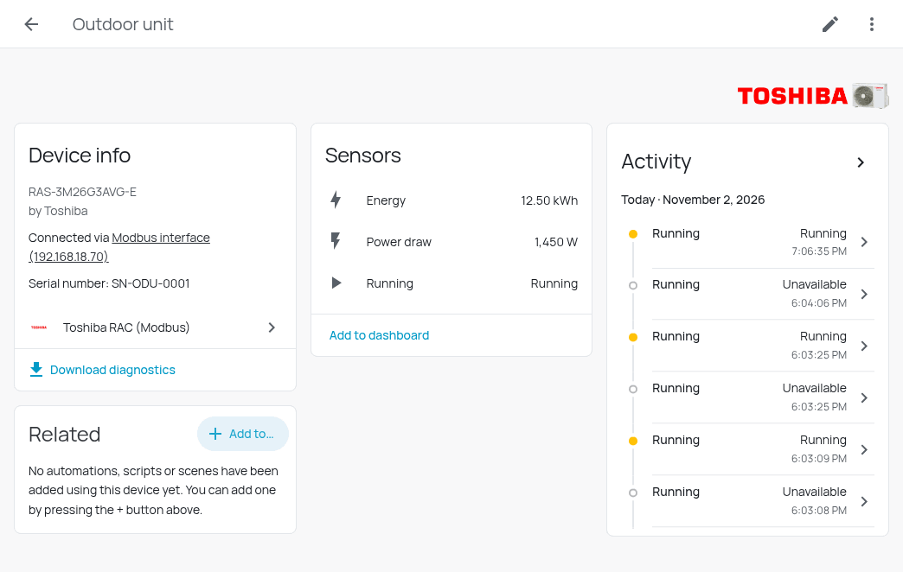

# Entities

Entity names below are the English ones; Polish translations ship with the integration. Every entity is
enabled by default. Entities that mainly matter while commissioning carry the diagnostic category, so they
sit in their own section of the device page instead of on the dashboard.

## Indoor unit (one device each)

| Platform | Entity | Notes |
|---|---|---|
| `climate` | the unit | Power, setpoint 17 to 30 °C in 0.5 °C steps, mode, fan, swing. No `hvac_action`, see below |
| `select` | Power limit | The Save operation rate (`no_limit`, `variable`, `half`; `full_save` is not available on RAC) |
| `switch` | Hi-Power, ECO, Quiet FCU, Silence CDU | Disable themselves when register `30059` says the unit does not support them |
| `switch` | Remote lock: power, mode, setpoint, louver, fan, ventilation | The remote-controller lock bits |
| `button` | Reset filter sign | |
| `sensor` | Setpoint, Mode, Fan, Louver (readback) | What the unit reports, as opposed to what was written |
| `sensor` | Capacity, Operating hours | |
| `sensor` | Check code | Decoded, see below. States `No active error` when clear |
| `sensor` | Model, Serial number | |
| `binary_sensor` | Power, Filter, Alarm | |
| `binary_sensor` | Pure Filter, Hi-Power, ECO, Quiet FCU, Silence CDU (status) | |

### Climate attributes

| Attribute | Meaning |
|---|---|
| `check_code` | The raw word, for example `0x4019`; `0x0000` is no error |
| `check_code_description` | `19: TD sensor (Discharge pipe temperature sensor) error` |
| `rac_functions` | The RAC functions the unit supports (`pure_filter`, `hi_power`, `eco`, `quiet_fcu`, `silence_cdu`) |
| `kod_bledu`, `kod_bledu_opis`, `funkcje_rac` | **Deprecated** Polish aliases of the three above, kept for dashboards written against 0.x. Removed in 2.0.0 |

### Check codes

The check code comes from the tables of Service Manual A10-2103-7 rev. 7, section 9-3, for both interface types
(residential `0x40xx`, light commercial `0x00` to `0xFD`). The text starts with the code the remote controller would show.
A code that the manual does not list is shown as `0xNNNN`; please open an issue with the value and the unit model.
Outdoor-unit faults such as `1F: Compressor break down` arrive through this code, because the interface reports them
as the indoor unit's check code.

### Why there is no `hvac_action`

A RAC interface never sets the thermo bit (`10004`), and the mode register says what was asked for, not what
the unit is doing. Releases up to 0.4.0 built `hvac_action` on it and showed `idle` while the unit cooled. With a
power meter on the outdoor unit you can see whether the compressor works (see *Outdoor unit*), but one meter cannot tell which
of several rooms is the reason, so the attribute stays absent.

## Modbus interface (parent device)

| Platform | Entity | Notes |
|---|---|---|
| `binary_sensor` | Connectivity | Stays available exactly when the bus is not |
| `sensor` | Bus messages, Communication errors, Messages to interface | Function `0x08` counters, answered by the interface itself |
| `sensor` | Frames last cycle, Units present, Slave address | |
| `sensor` | Interface status | `suspended` and `address_duplicated` are the states to alert on: the interface still answers diagnostics but no longer serves the units |
| `sensor` | Exception responses, Messages without response, Busy responses, Character overruns | Rare-event counters, read every five minutes |
| `button` | Find indoor units | |

The interface's software version (registers `39985` to `39992`) is shown as the firmware of the device. The error
counter is the one worth watching: rising while the connection looks fine means interference on RS-485, or a second
master on the same line.

## Outdoor unit (optional)

Created only when a power sensor is chosen in the setup or the options.

| Platform | Entity | Notes |
|---|---|---|
| `sensor` | Power draw | Mirror of the chosen power sensor |
| `sensor` | Energy | Mirror of the chosen energy sensor, with its unit and state class. Only if an energy sensor was chosen |
| `binary_sensor` | Running | On when power is at or above the threshold. Unknown while the meter reads `unavailable` |

These entities follow the meter's own state changes rather than the Modbus poll, and are available as long as the meter is.

## Diagnostics

*Download diagnostics* on the interface device returns the connection settings (including the gateway address),
the bus counters, the units with their names, models and presence, and the raw registers behind every entity.
There are no credentials in it, but read it before posting it in public: it names your gateway and your rooms.
