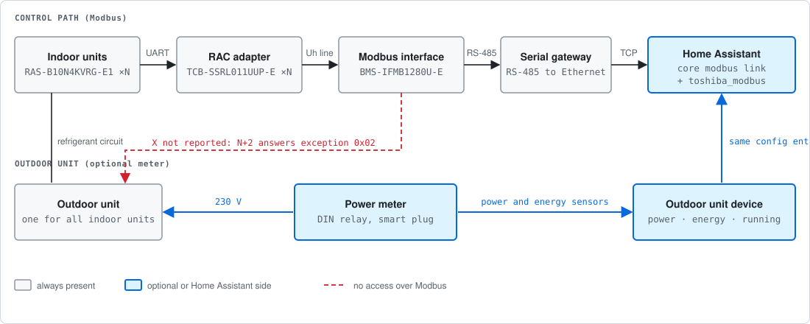

# Installation

## What you need

| | |
|---|---|
| Home Assistant | **2026.9** or later. The integration borrows its Modbus link from the core `modbus` integration, which is loaded as a dependency; nothing needs configuring in `modbus` itself |
| Interface | One **BMS-IFMB1280U-E** Modbus interface for the site |
| Indoor units | One **TCB-SSRL011UUP-E** RAC adapter per indoor unit, up to 64 |
| Gateway | An RS-485 to Ethernet gateway in front of the interface (transparent bridge such as an Elfin EW11, or a gateway that converts MBAP to RTU such as a Waveshare in mode 5) |
| Network | The gateway reachable from Home Assistant over TCP |

### Settings on the interface that decide whether it works

- **Central controller ID** must be `old controller` when RAC adapters are used (Service Manual
  A10-2103-7 rev. 7, p. 16). The factory value is ID20 and it silently does not work.
- **Slave address** (switch **SW1**) is entered in the integration; the two must match.
- **One master per bus.** Serial gateways tested here accept several TCP clients but do not
  correlate replies to them, so a second poller receives frames answering someone else's request.
  Point exactly one thing at the gateway.

## Install with HACS

1. In HACS open *Integrations*, search for **Toshiba RAC (Modbus)** (it is in the default store)
   and download it. If your HACS does not list it yet, add
   `https://github.com/jrx-code/hassio-toshiba-modbus` as a custom repository of type *Integration*.
2. Restart Home Assistant.
3. Continue with [Configuration](configuration.md).

HACS downloads `toshiba_modbus.zip` from the release and unpacks it into
`custom_components/toshiba_modbus`, so an install is one download.

## Install manually

1. Download `toshiba_modbus-<version>.zip` from the
   [latest release](https://github.com/jrx-code/hassio-toshiba-modbus/releases/latest). Check it against
   `SHA256SUMS.txt` from the same release.
2. Unpack it over your `config/` directory; the archive already carries the
   `custom_components/toshiba_modbus/` path.
3. Restart Home Assistant.

## Update

HACS shows an update when a release is published. Download it and restart Home Assistant.
Configuration and entity ids survive an update. Read the [changelog](../CHANGELOG.md) first: from
1.0.0 on, a change that needs action from you is a major version.

## Remove

Delete the entry under *Settings, Devices & services*, then remove the integration in HACS (or delete
`custom_components/toshiba_modbus`) and restart.
